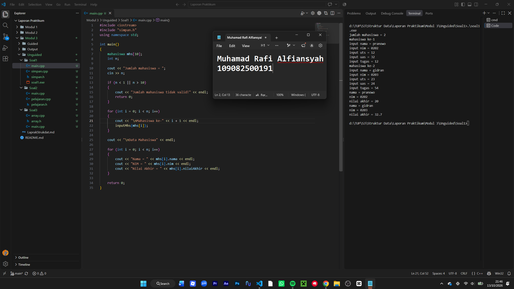
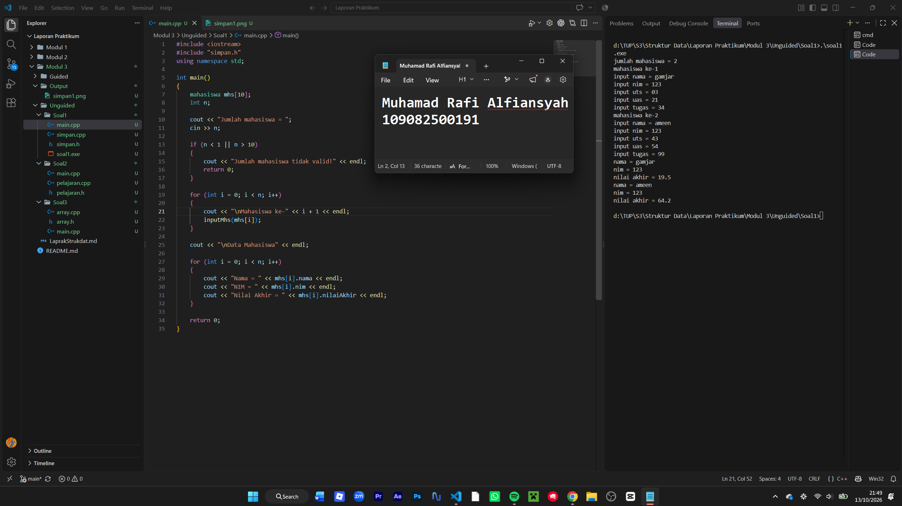
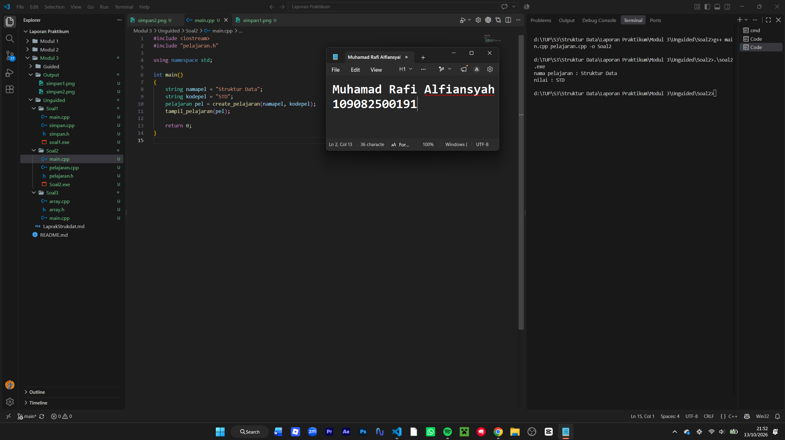
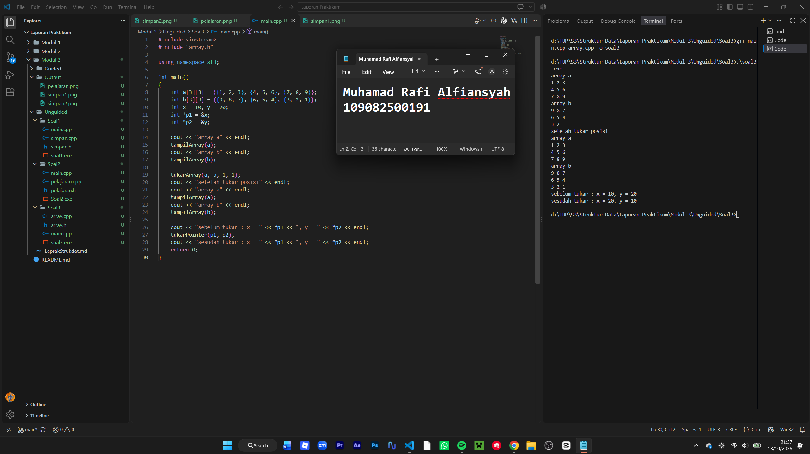

# <h1 align="center">Laporan Praktikum Modul 3 - Abstract Data Type (ADT)</h1>

<p align="center">Muhamad Rafi Alfiansyah - 109082500191</p>

## Dasar Teori

Dalam pemrograman C++, data dan proses dalam program dapat dikelola menggunakan beberapa konsep dasar. Konsep yang digunakan pada praktikum ini meliputi array, pointer, fungsi, prosedur, dan parameter. Konsep-konsep tersebut dapat digunakan bersama untuk mengolah data dan menyusun program agar lebih terorganisir.

### A. Konsep Dasar C++

#### 1. Array

Array digunakan untuk menampung beberapa data yang memiliki tipe data sama dalam satu variabel. Setiap data di dalam array memiliki posisi yang disebut indeks. Pada C++, indeks array dimulai dari angka `0`. Array satu dimensi dapat menyimpan data dalam bentuk deretan, sedangkan array dua dimensi menyimpan data dalam bentuk baris dan kolom.

#### 2. Pointer

Pointer adalah variabel yang menyimpan alamat memori dari variabel lain. Operator `&` digunakan untuk memperoleh alamat variabel, sedangkan operator `*` digunakan untuk mengakses nilai pada alamat yang ditunjuk. Pointer dapat digunakan untuk mengakses dan mengubah nilai variabel melalui alamat memorinya.

#### 3. Fungsi

Fungsi merupakan bagian program yang dibuat untuk mengerjakan proses tertentu. Fungsi dapat menerima data melalui parameter dan mengembalikan nilai menggunakan `return`. Pemakaian fungsi membuat kode lebih teratur dan mengurangi penulisan proses yang sama secara berulang.

#### 4. Prosedur

Prosedur digunakan untuk menjalankan pekerjaan tanpa menghasilkan nilai balik. Dalam C++, prosedur umumnya ditulis menggunakan fungsi bertipe `void`. Prosedur membantu memisahkan tugas tertentu dari program utama.

#### 5. Parameter Fungsi

Parameter digunakan untuk memasukkan data ke dalam fungsi. Pada C++, data dapat dikirim menggunakan `pass by value`, `pass by pointer`, atau `pass by reference`. `Pass by value` mengirimkan salinan nilai, sedangkan pointer dan reference memungkinkan fungsi mengakses atau mengubah variabel asal.

## Guided

### 1. Buku

**`buku.h`**

```cpp
#ifndef BUKU_H
#define BUKU_H
#include <iostream>

using namespace std;

struct Buku
{
    string judul;
    int halaman;
    string penulis;
};

void editIsi(string judul, int halaman, string penulis, Buku &buku);
void tampilkanIsiBuku(Buku buku);
bool checkPenulis(Buku buku);

#endif
```

**`buku.cpp`**

```cpp
#include "buku.h"

void editIsi(string judul, int halaman, string penulis, Buku &buku)
{
    buku.judul = judul;
    buku.halaman = halaman;
    buku.penulis = penulis;
}

void tampilkanIsiBuku(Buku buku)
{
    cout << "Judul: " << buku.judul << endl;
    cout << "Halaman: " << buku.halaman << endl;
    cout << "Penulis: " << buku.penulis << endl;
}

bool checkPenulis(Buku buku)
{
    return buku.penulis == "";
}
```

**`main.cpp`**

```cpp
#include <iostream>
#include "buku.h"

using namespace std;

int main()
{
    Buku novel;
    string judul, penulis;
    int halaman;

    cout << "Masukkan judul buku: ";
    cin >> judul;
    cout << "Masukkan jumlah halaman: ";
    cin >> halaman;
    cout << "Masukkan nama penulis: ";
    cin >> penulis;

    editIsi(judul, halaman, penulis, novel);
    tampilkanIsiBuku(novel);

    cout << checkPenulis(novel) << endl;

    return 0;
}
```

### 2. Mahasiswa

**`mahasiswa.h`**

```cpp
#ifndef MAHASISWA_H
#define MAHASISWA_H

struct mahasiswa
{
    char nim[10];
    int nilai1, nilai2;
};

void inputMhs(mahasiswa &m);
float rata2(mahasiswa m);

#endif
```

**`mahasiswa.cpp`**

```cpp
#include <iostream>
#include "mahasiswa.h"
using namespace std;

void inputMhs(mahasiswa &m)
{
    cout << "Masukkan NIM: ";
    cin >> m.nim;
    cout << "Masukkan nilai pertama: ";
    cin >> m.nilai1;
    cout << "Masukkan nilai kedua: ";
    cin >> m.nilai2;
}

float rata2(mahasiswa m)
{
    return (m.nilai1 + m.nilai2) / 2.0;
}
```

**`main.cpp`**

```cpp
#include <iostream>
#include "mahasiswa.h"
using namespace std;

int main()
{
    mahasiswa mhs;
    inputMhs(mhs);
    cout << "rata-rata = " << rata2(mhs) << endl;
    return 0;
}
```

## Unguided

### 1. Mahasiswa

Buat program yang menyimpan maksimal 10 data mahasiswa dalam array dengan field nama, NIM, UTS, UAS, tugas, dan nilai akhir. Nilai akhir dihitung dengan rumus `0.3 * UTS + 0.4 * UAS + 0.3 * tugas`.

**`simpan.h`**

```cpp
#ifndef SIMPAN_H
#define SIMPAN_H

#include <string>
using namespace std;

struct mahasiswa
{
    string nama;
    string nim;
    float uts;
    float uas;
    float tugas;
    float nilaiAkhir;
};

void inputMhs(mahasiswa &m);
float hitungNilaiAkhir(float uts, float uas, float tugas);

#endif
```

**`simpan.cpp`**

```cpp
#include <iostream>
#include "simpan.h"
using namespace std;

void inputMhs(mahasiswa &m)
{
    cout << "Nama: ";
    getline(cin >> ws, m.nama);
    cout << "NIM: ";
    cin >> m.nim;
    cout << "Nilai UTS: ";
    cin >> m.uts;
    cout << "Nilai UAS: ";
    cin >> m.uas;
    cout << "Nilai Tugas: ";
    cin >> m.tugas;

    m.nilaiAkhir = hitungNilaiAkhir(m.uts, m.uas, m.tugas);
}

float hitungNilaiAkhir(float uts, float uas, float tugas)
{
    return 0.3 * uts + 0.4 * uas + 0.3 * tugas;
}
```

**`main.cpp`**

```cpp
#include <iostream>
#include "simpan.h"
using namespace std;

int main()
{
    mahasiswa mhs[10];
    int n;

    cout << "Jumlah mahasiswa = ";
    cin >> n;

    if (n < 1 || n > 10)
    {
        cout << "Jumlah mahasiswa tidak valid!" << endl;
        return 0;
    }

    for (int i = 0; i < n; i++)
    {
        cout << "\nMahasiswa ke-" << i + 1 << endl;
        inputMhs(mhs[i]);
    }

    cout << "\nData Mahasiswa" << endl;

    for (int i = 0; i < n; i++)
    {
        cout << "Nama = " << mhs[i].nama << endl;
        cout << "NIM = " << mhs[i].nim << endl;
        cout << "Nilai Akhir = " << mhs[i].nilaiAkhir << endl;
    }

    return 0;
}
```

#### Output Unguided 1



#### Output Unguided 2



Program menyimpan data mahasiswa dalam array dengan kapasitas maksimal 10 data. Fungsi `inputMhs()` menerima identitas dan nilai setiap mahasiswa, sedangkan `hitungNilaiAkhir()` menghitung nilai akhir berdasarkan bobot UTS 30%, UAS 40%, dan tugas 30%. Setelah semua data dimasukkan, program menampilkan nama, NIM, dan nilai akhir setiap mahasiswa.

### 2. Pelajaran

Buat ADT `Pelajaran` yang memiliki `namaMapel` dan `kodeMapel`, kemudian buat fungsi kreator dan prosedur untuk menampilkan data.

**`pelajaran.h`**

```cpp
#ifndef PELAJARAN_H_INCLUDED
#define PELAJARAN_H_INCLUDED

#include <string>
using namespace std;

struct pelajaran
{
    string namaMapel;
    string kodeMapel;
};

pelajaran create_pelajaran(string namapel, string kodepel);
void tampil_pelajaran(pelajaran pel);

#endif
```

**`pelajaran.cpp`**

```cpp
#include <iostream>
#include "pelajaran.h"
using namespace std;

pelajaran create_pelajaran(string namapel, string kodepel)
{
    pelajaran p;
    p.namaMapel = namapel;
    p.kodeMapel = kodepel;
    return p;
}

void tampil_pelajaran(pelajaran pel)
{
    cout << "nama pelajaran : " << pel.namaMapel << endl;
    cout << "nilai : " << pel.kodeMapel << endl;
}
```

**`main.cpp`**

```cpp
#include <iostream>
#include "pelajaran.h"
using namespace std;

int main()
{
    string namapel = "Struktur Data";
    string kodepel = "STD";
    pelajaran pel = create_pelajaran(namapel, kodepel);
    tampil_pelajaran(pel);
    return 0;
}
```

#### Output Unguided 2



Program menggunakan `struct pelajaran` untuk menyimpan nama dan kode mata pelajaran. Fungsi `create_pelajaran()` membuat objek pelajaran dan mengisi kedua field tersebut, sedangkan `tampil_pelajaran()` menampilkan data yang sudah dibuat.

### 3. Array 2D dan Pointer

Buat program dengan dua array integer 2D berukuran 3x3 dan dua pointer integer. Program harus dapat menampilkan array, menukar isi array pada posisi tertentu, dan menukar isi dua variabel yang ditunjuk pointer.

**`array.h`**

```cpp
#ifndef OPERASI_H_INCLUDED
#define OPERASI_H_INCLUDED

void tampilArray(int arr[3][3]);
void tukarArray(int a[3][3], int b[3][3], int baris, int kolom);
void tukarPointer(int *p1, int *p2);

#endif
```

**`array.cpp`**

```cpp
#include <iostream>
#include "array.h"
using namespace std;

void tampilArray(int arr[3][3])
{
    for (int i = 0; i < 3; i++)
    {
        for (int j = 0; j < 3; j++)
        {
            cout << arr[i][j] << " ";
        }
        cout << endl;
    }
}

void tukarArray(int a[3][3], int b[3][3], int baris, int kolom)
{
    int temp = a[baris][kolom];
    a[baris][kolom] = b[baris][kolom];
    b[baris][kolom] = temp;
}

void tukarPointer(int *p1, int *p2)
{
    int temp = *p1;
    *p1 = *p2;
    *p2 = temp;
}
```

**`main.cpp`**

```cpp
#include <iostream>
#include "array.h"
using namespace std;

int main()
{
    int a[3][3] = {{1, 2, 3}, {4, 5, 6}, {7, 8, 9}};
    int b[3][3] = {{9, 8, 7}, {6, 5, 4}, {3, 2, 1}};
    int x = 10, y = 20;
    int *p1 = &x;
    int *p2 = &y;

    cout << "array a" << endl;
    tampilArray(a);
    cout << "array b" << endl;
    tampilArray(b);

    tukarArray(a, b, 1, 1);
    cout << "setelah tukar posisi" << endl;
    cout << "array a" << endl;
    tampilArray(a);
    cout << "array b" << endl;
    tampilArray(b);

    cout << "sebelum tukar : x = " << *p1 << ", y = " << *p2 << endl;
    tukarPointer(p1, p2);
    cout << "sesudah tukar : x = " << *p1 << ", y = " << *p2 << endl;
    return 0;
}
```

#### Output Unguided 3



Program menampilkan dua array berukuran 3x3, kemudian menukar elemen pada baris kedua dan kolom kedua. Fungsi `tukarArray()` melakukan pertukaran elemen pada kedua array, sedangkan `tukarPointer()` menukar nilai variabel yang ditunjuk oleh pointer `p1` dan `p2`.

## Kesimpulan

Praktikum Modul 3 membahas penyusunan program menggunakan struktur data dan fungsi yang dipisahkan ke dalam file header, file implementasi, serta program utama. Penerapan tersebut terlihat pada pengelolaan data mahasiswa, pembuatan ADT pelajaran, penggunaan array dua dimensi, dan pertukaran nilai dengan pointer.

## Referensi

[1] Triase. (2020). *Diktat Edisi Revisi: Struktur Data*. Medan: Universitas Islam Negeri Sumatera Utara Medan.

[2] Indahyati, Uce, dan Rahmawati Yunianita. (2020). *Buku Ajar Algoritma dan Pemrograman dalam Bahasa C++*. Sidoarjo: Umsida Press. https://doi.org/10.21070/2020/978-623-6833-67-4.
