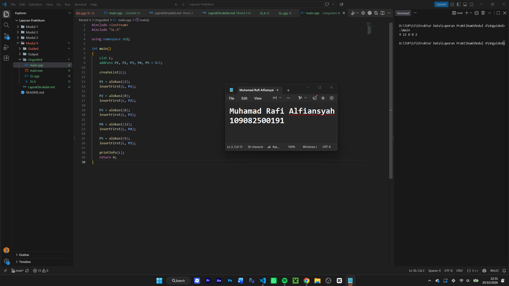

# <h1 align="center">Laporan Praktikum Modul 4 - Singly Linked List (Bagian Pertama)</h1>

<p align="center">Muhamad Rafi Alfiansyah - 109082500191</p>

## Dasar Teori

Linked list adalah struktur data yang terdiri dari beberapa node yang saling terhubung menggunakan pointer. Setiap node menyimpan data dan alamat node berikutnya. Berbeda dengan array yang ukurannya tetap, linked list bersifat dinamis sehingga dapat bertambah atau berkurang sesuai kebutuhan.

### A. Singly Linked List

Singly linked list adalah linked list yang setiap nodenya hanya memiliki satu pointer `next`. Pointer tersebut menunjuk ke node berikutnya, dan node terakhir menunjuk ke `Nil`. Pointer `First` digunakan untuk menyimpan alamat node pertama dalam list.

Komponen utama singly linked list adalah:

1. `info`, yaitu data yang disimpan pada node.
2. `next`, yaitu pointer yang menunjuk ke node berikutnya.
3. `First`, yaitu pointer yang menunjuk ke node pertama.
4. `Nil`, yaitu penanda bahwa pointer tidak menunjuk node mana pun.

### B. Operasi Dasar yang Digunakan

Pada praktikum ini operasi yang digunakan adalah `createList`, `alokasi`, `dealokasi`, `insertFirst`, dan `printInfo`. `createList` membentuk list kosong dengan mengisi `First` dengan `Nil`. `insertFirst` menyisipkan node baru di awal list, sehingga node yang terakhir disisipkan akan berada di posisi paling depan. `printInfo` menelusuri list mulai dari `First`, lalu berpindah menggunakan `next` sampai pointer bernilai `Nil`.

### C. Alokasi dan Dealokasi Memori

Node baru dibuat secara dinamis menggunakan operator `new`. Setelah node tidak digunakan, memori dikembalikan menggunakan `delete`. Proses pembuatan node disebut alokasi, sedangkan proses membebaskan memori disebut dealokasi.

## Guided

### 1. Buku

**`list.h`**

```cpp
#ifndef LIST_H
#define LIST_H
#define NIL NULL

#include <iostream>
using namespace std;

struct mahasiswa
{
    string nama, nim;
    int umur;
};

typedef mahasiswa dataMahasiswa;
typedef struct node *address;

struct node
{
    dataMahasiswa info;
    address next;
};

struct LinkedList
{
    address first;
};

bool isEmpty(LinkedList List);
void createList(LinkedList &List);
address alokasi(string nama, string nim, int umur);
void dealokasi(address &node);
void printList(LinkedList List);
void insertFirst(LinkedList &List, address nodeBaru);
void insertAfter(LinkedList &List, address nodeBaru, address prev);
void insertLast(LinkedList &List, address nodeBaru);

void delFirst(LinkedList &List);
void delLast(LinkedList &List);
void delAfter(LinkedList &List, address nodeHapus, address nodePrev);
int nbList(LinkedList List);
void deleteList(LinkedList &List);
#endif
```

**`list.cpp`**

```cpp
#include "List.h"
#include <iostream>
using namespace std;

bool isEmpty(LinkedList List)
{
 if (List.first == NIL)
 {
    return true;
 }
 else
 {
    return false;
 }
}

void createList(LinkedList &List)
{
    List.first = NIL;
}

address alokasi(string nama, string nim, int umur)
{
    address nodeBaru = new node;
    nodeBaru->isidata.nama = "nama";
    nodeBaru->isidata.nim = "nim";
    nodeBaru->isidata.umur = "umur";
    nodeBaru->next = NIL;
    return nodeBaru;
}

void dealokasi(address &node)
{
    node->next = NIL;
    delete node;
}

void insertFirst(LinkedList &List, address nodeBaru)
{
    nodeBaru->next = List.first;
    List.first = nodeBaru;
}

void insertAfter(LinkedList &List, address nodeBaru, address prev)
{
    if(prev != NIL)
    {
        nodeBaru->next = prev->next;
        prev->next = nodeBaru;
    }
    else
    {
        cout << "Node sebelumnya tidak valid." << endl;
    }
}

void insertLast(LinkedList &List, address nodeBaru)
{
    if (isEmpty(List))
    {
        List.first = nodeBaru;
    }
    else
    {
        address nodeBaru = List.first;
        while (nodeBaru->next != NIL)
        {
            nodeBantu = nodeBantu->next;
        }
        nodeBantu->next = nodeBaru;
    }
}

void delFirst(LinkedList &List)
{
    address nodeHapus;
    if (!isEmpty(List)== false)
    {
        nodeHapus = List.first;
        nodeHapus->next = NIL;
        delaokasi(nodeHapus);
    }
    else
    {
        cout << "List kosong!" << endl;
    }
}

void delLast(LinkedList &List)
{
    address nodeHapus, nodePrev;
    if (!isEmpty(List) == false)
    {
        nodeHapus = List.first;
        if (nodeHapus->next == NIL)
        {
            List.first->next = NIL;
            dealokasi(nodeHapus);
        }
        else
        {
            while (nodeHapus->next != NIL)
            {
                nodePrev = nodeHapus;
                nodeHapus = nodeHapus->next;
            }
            nodePrev->next = NIL;
            dealokasi(nodeHapus);
        }
    }
    else
    {
        cout << "List kosong!" << endl;
    }
}

void delAfter(LinkedList &List, address nodeHapus, address nodePrev)
{
    if (isEmpty(List) == true)
    {
        cout << "List kosong!" << endl;
    }
    else
    {
        if (nodePrev != NIL && nodePrev->next != NIL)
        {
            nodeHapus = nodePrev->next;
            nodePrev->next = nodeHapus->next;
            nodeHapus->next = NIL;
            dealokasi(nodeHapus);
        }
        else
        {
            cout << "Node sebelumnya (prev) tidak valid." << endl;
        }
    }
}
#include "list.h"
#include <iostream>
using namespace std;

bool isEmpty(linkedlist  List)
{
    if (List.first == Nil)
    {
        return true;
    }
    else 
    {
        return false;
    }
}

void createList(linkedlist &List)
{
    List.first = Nil;
}

address alokasi(string nama, string nim, int umur)
{
    address nodeBaru = new node;
    nodeBaru->isidata.nama = nama;
    nodeBaru->isidata.nim = nim;
    nodeBaru->isidata.umur = umur;
    nodeBaru->next = Nil;
    return nodeBaru;
}

void dealokasi(address &node)
{
    node->next = Nil;
    delete node;
}

void insertFirst(linkedlist &List, address nodeBaru)
{
    nodeBaru->next = List.first;
    List.first = nodeBaru;
}

void insertAfter(linkedlist &List, address nodeBaru, address Prev)
{
    if (Prev != Nil)
    {
        nodeBaru->next = Prev->next;
        Prev->next = nodeBaru;
    }
    else
    {
        cout << "Node sebelumnya tidak valid!" << endl;
    }
}

void insertLast(linkedlist &List, address nodeBaru)
{
    if (isEmpty(List))
    {
        List.first = nodeBaru;
    }
    else
    {
        address nodeBantu = List.first;
        while (nodeBantu->next != Nil)
        {
            nodeBantu = nodeBantu->next;
        }
        nodeBantu->next = nodeBaru;
    }
}

void delFirst(linkedlist &List)
{
    address nodeHapus;
    if (isEmpty(List) == false)
    {
        nodeHapus = List.first;
        List.first = List.first->next;
        nodeHapus->next = Nil;
        dealokasi(nodeHapus);
    }
    else
    {
        cout << "List kosong!" << endl;
    }
}

void delLast(linkedlist &List)
{
    address nodeHapus, nodePrev;
    if (isEmpty(List) == false)
    {
        nodeHapus = List.first;
        if (nodeHapus->next == Nil)
        {
            List.first->next = Nil;
            dealokasi(nodeHapus);
        }
        else
        {
            while (nodeHapus->next != Nil)
            {
                nodePrev = nodeHapus;
                nodeHapus = nodeHapus->next;
            }
            nodePrev->next = Nil;
            dealokasi(nodeHapus);
        }
    }
    else
    {
        cout << "List kosong" << endl;
    }
}

void delAfter(linkedlist &List, address nodeHapus, address nodePrev)
{
    if (isEmpty(List) == true)
    {
        cout << "List kosong!" << endl;
    }
    else
    {
        if (nodePrev != Nil && nodePrev->next != Nil)
        {
            nodeHapus = nodePrev->next;
            nodePrev->next = nodeHapus->next;
            nodeHapus->next = Nil;
            dealokasi(nodeHapus);
        }
        else
        {
            cout << "Node sebelumnya (prev) tidak valid!" << endl;
        }
    }
}

void printList(linkedlist list)
{
    if (isEmpty(list) == true)
    {
        cout << "List kosong!" << endl;
    }
    else
    {
        address nodeBantu = list.first;
        while (nodeBantu != Nil)
        {
            cout << "Nama: " << nodeBantu->isidata.nama << ", NIM: " << nodeBantu->isidata.nim << ", Usia: " << nodeBantu->isidata.umur << endl;
            nodeBantu = nodeBantu->next;
        }
    }
}

int nbList(linkedlist list)
{
    int count = 0;
    address nodeBantu = list.first;
    while (nodeBantu != Nil)
    {
        count++;
        nodeBantu = nodeBantu->next;
    }
    return count;
}

void deleteList(linkedlist &list)
{
    address nodeBantu, nodeHapus;
    nodeBantu = list.first;
    while (nodeBantu != Nil)
    {
        nodeHapus = nodeBantu;
        nodeBantu = nodeBantu->next;
        dealokasi(nodeHapus);
    }
    list.first = Nil;
    cout << "List sudah terhapus." << endl;
}
```

**`main.cpp`**

```cpp
#include "list.h"
using namespace std;

int main()
{
    linkedlist List;
    address nodeA, nodeB, nodeC, nodeD, nodeE = Nil;
    createList(List);

    nodeA = alokasi("Dhimas", "2311102151", 20);
    nodeB = alokasi("Arvin", "221110014", 21);
    nodeC = alokasi("Rizal", "231110029", 20);
    nodeD = alokasi("Satrio", "2211102173", 21);
    nodeE = alokasi("Joshua", "2311102133", 21);

    insertFirst(List, nodeA);
    insertLast(List, nodeB);
    insertAfter(List, nodeC, nodeA);
    insertAfter(List, nodeD, nodeC);
    insertLast(List, nodeE);

    cout << "--- ISI LIST SETELAH DILAKUKAN INSERT ---" << endl;
    printList(List);
    cout << "jumlah node : " << nbList(List) << endl;
    cout << endl;

    delFirst(List);
}
```
Program menggunakan struct Buku untuk menyimpan data buku. Fungsi editIsi() mengisi data, tampilkanIsiBuku() menampilkan data, dan checkPenulis() memeriksa nama penulis.

## Unguided

### 1. Mahasiswa

Buat program yang menyimpan maksimal 10 data mahasiswa dalam array dengan field nama, NIM, UTS, UAS, tugas, dan nilai akhir. Nilai akhir dihitung dengan rumus `0.3 * UTS + 0.4 * UAS + 0.3 * tugas`.

**`SL.h`**

```cpp
#ifndef SL_H_INCLUDED
#define SL_H_INCLUDED

#define Nil NULL

using namespace std;

typedef int infotype;
typedef struct ElmList *address;

struct ElmList {
    infotype info;
    address next;
};

struct List {
    address First;
};

void createList(List &L);
address alokasi(infotype x);
void dealokasi(address &P);
void printInfo(List L);
void insertFirst(List &L, address P);

#endif
```

**`SL.cpp`**

```cpp
#include <iostream>
#include "SL.h"

using namespace std;

void createList(List &L) {
    L.First = Nil;
}

address alokasi(infotype x) {
    address P = new ElmList;
    P->info = x;
    P->next = Nil;
    return P;
}

void dealokasi(address &P) {
    delete P;
}

void printInfo(List L) {
    address P = L.First;
    while (P != Nil) {
        cout << P->info << " ";
        P = P->next;
    }
    cout << endl;
}

void insertFirst(List &L, address P) {
    P->next = L.First;
    L.First = P;
}
```

**`main.cpp`**

```cpp
#include <iostream>
#include "SL.h"

using namespace std;

int main()
{
    List L;
    address P1, P2, P3, P4, P5 = Nil;

    createList(L);

    P1 = alokasi(2);
    insertFirst(L, P1);

    P2 = alokasi(0);
    insertFirst(L, P2);

    P3 = alokasi(8);
    insertFirst(L, P3);

    P4 = alokasi(12);
    insertFirst(L, P4);

    P5 = alokasi(9);
    insertFirst(L, P5);

    printInfo(L);
    return 0;
}
```

#### Output Unguided 1




## Kesimpulan

Praktikum Modul 3 membahas penyusunan program menggunakan struktur data dan fungsi yang dipisahkan ke dalam file header, file implementasi, serta program utama. Penerapan tersebut terlihat pada pengelolaan data mahasiswa, pembuatan ADT pelajaran, penggunaan array dua dimensi, dan pertukaran nilai dengan pointer.

## Referensi

[1] Triase. (2020). *Diktat Edisi Revisi: Struktur Data*. Medan: Universitas Islam Negeri Sumatera Utara Medan.

[2] Indahyati, Uce, dan Rahmawati Yunianita. (2020). *Buku Ajar Algoritma dan Pemrograman dalam Bahasa C++*. Sidoarjo: Umsida Press. https://doi.org/10.21070/2020/978-623-6833-67-4.
