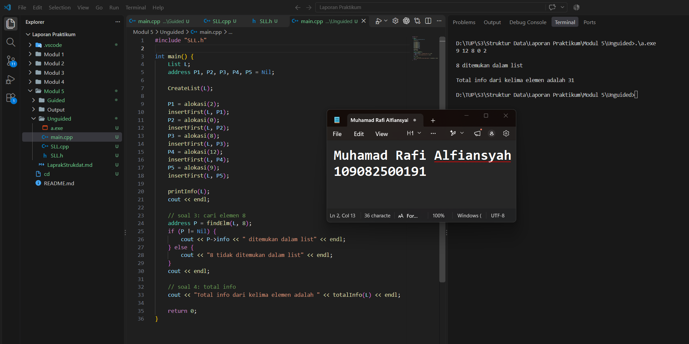

# Laporan Praktikum Modul 5 - Singly Linked List (Bagian Kedua)

<p align="center">Muhamad Rafi Alfiansyah - 109082500191</p>

## Dasar Teori

Linked list adalah struktur data yang terdiri dari kumpulan node yang saling terhubung lewat pointer. Tiap node menyimpan data dan alamat node berikutnya. Berbeda dengan array yang ukurannya ditentukan di awal, linked list memakai alokasi memori dinamis sehingga jumlah elemennya bisa bertambah atau berkurang saat program berjalan [1].

### A. Singly Linked List dan ADT

Singly linked list adalah linked list yang setiap nodenya punya satu pointer `next`. Pointer itu menunjuk ke node berikutnya, dan node terakhir menunjuk ke `Nil`. Karena arahnya hanya satu, penelusuran selalu dimulai dari node pertama (`head`) sampai node terakhir (`tail`) [1]. Pada modul ini, pointer ke node pertama disimpan di `First`.

Singly linked list dibuat dalam bentuk ADT (*Abstract Data Type*), yaitu definisi tipe data beserta operasi-operasinya. Hasilnya dipisah ke tiga file: `.h` untuk deklarasi tipe dan prototype fungsi, `.cpp` untuk isi fungsinya, dan `main.cpp` untuk mencoba ADT tersebut.

Komponen yang dipakai pada praktikum ini adalah:

- `infotype`, yaitu tipe data yang disimpan pada node, berupa `int`.
- `address`, yaitu pointer ke `ElmList`.
- `ElmList`, yaitu node yang berisi `info` dan `next`.
- `List`, yaitu struktur yang berisi `First`, penunjuk node pertama.
- `Nil`, yaitu penanda pointer yang tidak menunjuk node mana pun.

Modul menjelaskan prototype ADT yang lengkap, tetapi latihan Modul 5 memakai bagian yang dibutuhkan saja, yaitu `CreateList`, alokasi, dealokasi, `printInfo`, `insertFirst`, ditambah `findElm` untuk pencarian dan satu fungsi untuk menjumlahkan seluruh info.

### B. Alokasi, Dealokasi, dan insertFirst

Node baru dibuat dengan operator `new` di fungsi alokasi, lalu `info` diisi dan `next` diset `Nil`. Kalau node sudah tidak dipakai, memorinya dikembalikan ke sistem dengan `delete` di fungsi dealokasi supaya tidak terjadi *memory leak* [1].

`insertFirst` menyisipkan node di awal list dengan dua langkah: `next` node baru diarahkan ke `First`, lalu `First` dipindah ke node baru. Karena selalu disisipkan di depan, node yang paling akhir dimasukkan akan berada di posisi paling depan, sehingga urutan list kebalik dari urutan input.

### C. Searching pada Linked List

Searching adalah proses mencari node dengan data tertentu. Node pada linked list tidak bisa diakses langsung lewat indeks seperti array, jadi pencarian dilakukan berurutan dari `First`. Pointer bantu bergerak ke node berikutnya lewat `next` sampai data ditemukan atau pointer sudah bernilai `Nil` [1].

Cara ini sama dengan *sequential search*, yaitu data dibandingkan satu per satu dari awal sampai data yang dicari ketemu atau semua data sudah diperiksa [2][3][4].

Pada latihan, fungsi `findElm` dipakai untuk mencari node dengan `info` tertentu. Kalau ketemu, fungsi mengembalikan alamat node tersebut, dan kalau tidak ketemu mengembalikan `Nil`.

### D. Penelusuran List dan Kompleksitas

Menampilkan isi list dan menjumlahkan seluruh info sama-sama memakai penelusuran dari `First` sampai `Nil`, dengan satu pointer bantu yang berpindah lewat `next`. Untuk menjumlahkan info, nilai `info` tiap node ditambahkan ke variabel penampung selama penelusuran.

Pada sequential search, kompleksitas waktu rata-rata maupun kasus terburuk adalah O(n) [2]. Pada linked list, akses ke elemen tertentu harus menelusuri dari awal sehingga kompleksitasnya O(n), sedangkan akses lewat indeks pada array adalah O(1) [1]. Sebaliknya, `insertFirst` tidak perlu menelusuri list karena hanya mengubah dua pointer.

## Unguided

### 1. Implementasi ADT Singly Linked List

Buat ADT singly linked list dengan `infotype` bertipe integer, `address` sebagai pointer ke `ElmList`, serta operasi `CreateList`, alokasi, dealokasi, `printInfo`, dan `insertFirst`. Lalu coba di `main.cpp` dengan memasukkan data 2, 0, 8, 12, dan 9 memakai `insertFirst`.

**SLL.h**

```cpp
#ifndef SLL_H
#define SLL_H

#include <iostream>
#define Nil NULL

using namespace std;

typedef int infotype;
typedef struct ElmList *address;

struct ElmList {
    infotype info;
    address next;
};

struct List {
    address First;
};

void CreateList(List &L);
address alokasi(infotype x);
void dealokasi(address &P);
void printInfo(List L);
void insertFirst(List &L, address P);
address findElm(List L, infotype x);
int totalInfo(List L);

#endif
```

**SLL.cpp**

```cpp
#include "SLL.h"

void CreateList(List &L) {
    L.First = Nil;
}

address alokasi(infotype x) {
    address P = new ElmList;
    P->info = x;
    P->next = Nil;
    return P;
}

void dealokasi(address &P) {
    delete P;
    P = Nil;
}

void printInfo(List L) {
    address P = L.First;
    if (P == Nil) {
        cout << "List kosong" << endl;
    } else {
        while (P != Nil) {
            cout << P->info << " ";
            P = P->next;
        }
        cout << endl;
    }
}

void insertFirst(List &L, address P) {
    P->next = L.First;
    L.First = P;
}

address findElm(List L, infotype x) {
    address P = L.First;
    while (P != Nil) {
        if (P->info == x) {
            return P;
        }
        P = P->next;
    }
    return Nil;
}

int totalInfo(List L) {
    int total = 0;
    address P = L.First;
    while (P != Nil) {
        total = total + P->info;
        P = P->next;
    }
    return total;
}
```

**main.cpp**

```cpp
#include "SLL.h"

int main() {
    List L;
    address P1, P2, P3, P4, P5 = Nil;

    CreateList(L);

    P1 = alokasi(2);
    insertFirst(L, P1);

    P2 = alokasi(0);
    insertFirst(L, P2);

    P3 = alokasi(8);
    insertFirst(L, P3);

    P4 = alokasi(12);
    insertFirst(L, P4);

    P5 = alokasi(9);
    insertFirst(L, P5);

    printInfo(L);
    cout << endl;

    address P = findElm(L, 8);
    if (P != Nil) {
        cout << P->info << " ditemukan dalam list" << endl;
    } else {
        cout << "8 tidak ditemukan dalam list" << endl;
    }

    cout << endl;
    cout << "Total info dari kelima elemen adalah "
         << totalInfo(L) << endl;

    return 0;
}
```

#### Output Unguided 1



Program dimulai dengan `CreateList(L)` supaya `First` bernilai `Nil`. Setelah itu node dengan nilai 2, 0, 8, 12, dan 9 dibuat memakai `alokasi()` lalu disisipkan satu per satu dengan `insertFirst()`. Karena selalu masuk di depan, node yang terakhir dimasukkan (9) jadi yang paling depan. Hasilnya adalah `9 12 8 0 2`.

### 2. Mencari Elemen dengan findElm

Cari elemen dengan `info` 8 menggunakan fungsi `findElm(L, x)` yang mengembalikan alamat node jika ditemukan dan `Nil` jika tidak ditemukan.

Fungsi `findElm` sudah ditulis pada `SLL.h` dan `SLL.cpp` di atas. Pemanggilannya pada `main.cpp` adalah sebagai berikut:

```cpp
address P = findElm(L, 8);

if (P != Nil) {
    cout << P->info << " ditemukan dalam list" << endl;
} else {
    cout << "8 tidak ditemukan dalam list" << endl;
}
```

#### Output Unguided 2


`findElm` memakai pointer bantu `P` yang mulai dari `First`, lalu memeriksa satu per satu apakah `info` sama dengan nilai yang dicari. Pada list `9 12 8 0 2`, angka 8 ada di node ketiga, sehingga pencarian berhenti setelah memeriksa 9, 12, lalu 8. Hasilnya adalah `8 ditemukan dalam list`.

### 3. Menghitung Total Info Seluruh Elemen

Hitung jumlah total info seluruh elemen, yaitu 9 + 12 + 8 + 0 + 2 = 31.

Fungsi yang digunakan adalah `totalInfo(List L)` yang menelusuri list dari `First` sampai `Nil` dan menambahkan nilai `info` setiap node ke variabel `total`.

Pemanggilannya pada `main.cpp`:

```cpp
cout << "Total info dari kelima elemen adalah "
     << totalInfo(L) << endl;
```

#### Output Unguided 3


`totalInfo` menelusuri list dari `First` sampai `Nil` dengan variabel `total` yang dimulai dari 0. Setiap nilai `info` ditambahkan ke total, sehingga perhitungannya adalah 9 + 12 + 8 + 0 + 2 dan hasilnya 31.

## Kesimpulan

Dari praktikum ini aku jadi paham kalau ADT singly linked list dipisah menjadi tiga file, yaitu `SLL.h` untuk deklarasi tipe dan prototype, `SLL.cpp` untuk isi fungsinya, dan `main.cpp` untuk mencoba hasilnya. Node dibuat memakai `alokasi()` dengan `new`, kemudian disambungkan ke list lewat pointer `next`, sedangkan `dealokasi()` digunakan untuk mengembalikan memori dengan `delete`.

Hasil `insertFirst()` yang selalu menyisipkan node di depan membuat output menjadi `9 12 8 0 2`, kebalikan dari urutan input. Pada bagian searching, `findElm()` menelusuri list dari `First` sampai data ditemukan atau sampai `Nil`. Sementara itu, `totalInfo()` menjumlahkan seluruh nilai dalam list dan menghasilkan 31. Pencarian dan penjumlahan memiliki kompleksitas O(n) karena harus memeriksa node satu per satu.

## Referensi

[1] R. D. Setiyawan, D. Hermawan, A. F. Abdillah, A. Mujayanah, dan R. Vindua. (2024). Penggunaan Struktur Data Stack dalam Pemrograman C++ dengan Pendekatan Array dan Linked List. *JUTECH: Journal Education and Technology, 5*(2). https://doi.org/10.31932/jutech.v5i2.4263

[2] F. Assegaf, A. Suharso, dan A. Primajaya. (2023). Penerapan Algoritma Sequential Search pada Website Yayasan Nurul Iman Perum Taman Singaperbangsa Karawang. *JATI (Jurnal Mahasiswa Teknik Informatika), 7*(5), 3555–3564.

[3] A. Sonita dan M. Sari. (2018). Implementasi Algoritma Sequential Searching untuk Pencarian Nomor Surat pada Sistem Arsip Elektronik. *Pseudocode, 5*(1), 1–9. https://doi.org/10.33369/pseudocode.5.1.1-9

[4] Y. Religia. (2019). Analisis Algoritma Sequential Search dan Binary Search pada Big Data. *Pelita Teknologi: Jurnal Ilmiah Informatika, Arsitektur dan Lingkungan, 14*(1), 74–79.

[5] D. Markuci dan C. Prianto. (2022). Analisis Perbandingan Penggunaan Algoritma Sequential Search dan Binary Search pada Aplikasi Surat Perjalanan Dinas. *JATI (Jurnal Mahasiswa Teknik Informatika), 6*(1), 110–119. https://doi.org/10.36040/jati.v6i1.4569