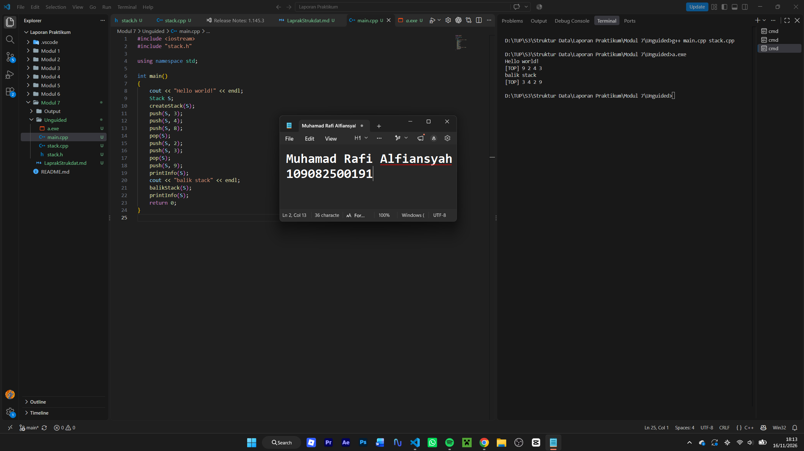
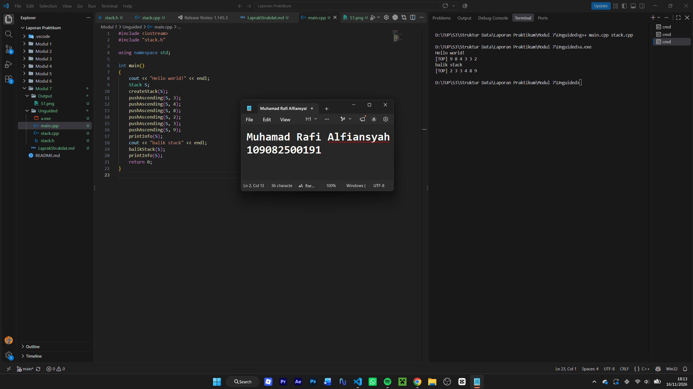
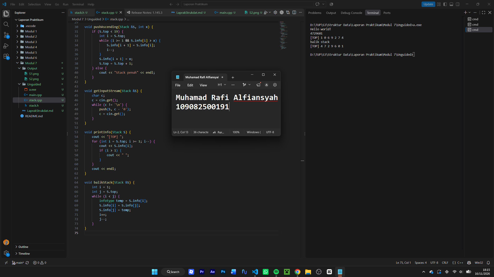

# <h1 align="center">Laporan Praktikum Modul 7 - STACK (BAGIAN PERTAMA)</h1>

<p align="center">Muhamad Rafi Alfiansyah - 109082500191</p>

## Dasar Teori

### A. Stack

Stack adalah struktur data linear yang menerapkan prinsip LIFO (Last In First Out), artinya data yang terakhir masuk akan jadi yang pertama keluar. Gampangnya seperti tumpukan piring, kita cuma bisa menaruh piring baru di paling atas dan mengambil juga dari paling atas. Karena itu semua operasi pada stack hanya terjadi di satu ujung, yang disebut top. Kalau mau mengambil data yang ada di bawah, data di atasnya harus dikeluarkan dulu.

### B. Stack dengan Array

Pada praktikum ini stack dibuat dengan ADT berbasis array. Stack disusun dari array info yang berisi maksimal 20 elemen dan variabel top yang menandai posisi elemen paling atas. Saat stack baru dibuat (createStack), top bernilai 0 yang berarti stack kosong. Operasi push menambah nilai top lebih dulu, baru data disimpan di info[top], sedangkan pop mengambil data di info[top] lalu mengurangi nilai top. Kalau stack sudah penuh lalu di-push terjadi overflow, dan kalau stack kosong lalu di-pop terjadi underflow. Keduanya perlu dicek. Kelebihannya implementasinya simpel dan hemat memori karena tidak butuh pointer, kekurangannya ukuran stack tetap sehingga tidak bisa bertambah saat program berjalan. Operasi push dan pop sama-sama O(1).

### C. Operasi pada Latihan

Selain push dan pop, ada beberapa operasi lain. printInfo menampilkan isi stack dari top ke bawah, jadi urutan tampilnya kebalikan dari urutan masuk. balikStack membalik isi stack dengan menukar elemen paling bawah dan paling atas, bergerak ke tengah sampai selesai. pushAscending menyisipkan data sambil menjaga stack tetap terurut naik dari bawah ke atas, caranya dengan menggeser elemen yang lebih besar dari data baru ke atas dulu. Terakhir, getInputStream membaca input user per karakter memakai cin.get() dan langsung mem-push setiap karakternya sampai user menekan enter.


## Guided

### 1. Implementasi Linked List Mahasiswa

**`listMakanan.h`**

```cpp
#ifndef LISTMAKANAN_H
#define LISTMAKANAN_H
#define Nil NULL

#include <iostream>
using namespace std;

struct makanan
{
    string nama;
    string jenis;
    float harga;
    float rating;
};

typedef makanan dataMakanan;

typedef struct node *address;

struct node
{
    dataMakanan isidata;
    address next;
    address prev;
};

struct linkedlist
{
    address first;
    address last;
};

bool isEmpty(linkedlist List);
void createList(linkedlist &List);
address alokasi(string nama, string jenis, float harga, float rating);
void dealokasi(address &node);

void insertFirst(linkedlist &List, address nodeBaru);
void insertLast(linkedlist &List, address nodeBaru);
void insertAfter(linkedlist &List, address nodeBaru, address Prev);
void insertBefore(linkedlist &List, address nodeBaru, address nodeNext);

void printList(linkedlist List);

void updateFirst(linkedlist List);
void updateLast(linkedlist List);
void updateAfter(linkedlist List, address prev);
void updateBefore(linkedlist List, address nodeNext);

// Searching
void findByName(linkedlist List, string nama);
void findByJenis(linkedlist List, string jenis);
void findByMinRating(linkedlist List, float minRating);

// Delete
void deleteFirst(linkedlist &List);
void deleteLast(linkedlist &List);
void deleteAfter(linkedlist &List, address Prev);
void deleteBefore(linkedlist &List, address nodeNext);

void deleteNode(linkedlist &List, address target);
void deleteByName(linkedlist &List, string nama);

#endif
```

**`listMakanan.cpp`**

```cpp
#include "listMakanan.h"
#include <iostream>
#include <string>
using namespace std;

bool isEmpty(linkedlist List)
{
    if (List.first == Nil)
    {
        return true;
    }
    else
    {
        return false;
    }
}

void createList(linkedlist &List)
{
    List.first = Nil;
    List.last = Nil;
}

// pembuatan node baru dengan menerapkan manajemen memori
address alokasi(string nama, string jenis, float harga, float rating)
{
    address nodeBaru = new node;
    nodeBaru->isidata.nama = nama;
    nodeBaru->isidata.jenis = jenis;
    nodeBaru->isidata.harga = harga;
    nodeBaru->isidata.rating = rating;
    nodeBaru->next = Nil;
    nodeBaru->prev = Nil;
    return nodeBaru;
}

void dealokasi(address &node)
{
    node->next = Nil;
    node->prev = Nil;
    delete node;
}

void insertFirst(linkedlist &List, address nodeBaru)
{
    if (isEmpty(List))
    {
        List.first = List.last = nodeBaru;
    }
    else
    {
        nodeBaru->next = List.first;
        List.first->prev = nodeBaru;
        List.first = nodeBaru;
    }
    cout << "Node " << nodeBaru->isidata.nama << " berhasil ditambahkan sebagai node pertama list" << endl;
}

void insertLast(linkedlist &List, address nodeBaru)
{
    if (isEmpty(List) == true)
    {
        List.first = List.last = nodeBaru;
    }
    else
    {
        nodeBaru->prev = List.last;
        List.last->next = nodeBaru;
        List.last = nodeBaru;
    }
    cout << "Node " << nodeBaru->isidata.nama << " berhasil ditambahkan sebagai node terakhir list" << endl;
}

void insertAfter(linkedlist &List, address nodeBaru, address nodePrev)
{
    if (isEmpty(List) == true)
    {
        List.first = List.last = nodeBaru;
    }
    else
    {
        if (nodePrev != Nil)
        {
            if (nodePrev == List.last)
            {
                insertLast(List, nodeBaru);
            }
            else
            {
                nodeBaru->next = nodePrev->next;
                nodeBaru->prev = nodePrev;
                (nodePrev->next)->prev = nodeBaru;
                nodePrev->next = nodeBaru;
                cout << "Node " << nodeBaru->isidata.nama << " berhasil ditambahkan setelah node " << nodePrev->isidata.nama << endl;
            }
        }
        else
        {
            cout << "node sebelumnya (nodePrev) tidak valid!" << endl;
        }
    }
}

void insertBefore(linkedlist &List, address nodeBaru, address nodeNext)
{
    if (isEmpty(List) == true)
    {
        List.first = List.last = nodeBaru;
    }
    else
    {
        if (nodeNext != Nil)
        {
            if (nodeNext == List.first)
            {
                insertFirst(List, nodeBaru);
            }
            else
            {
                nodeBaru->next = nodeNext;
                nodeBaru->prev = nodeNext->prev;
                (nodeNext->prev)->next = nodeBaru;
                nodeNext->prev = nodeBaru;
                cout << "Node " << nodeBaru->isidata.nama << " berhasil ditambahkan sebelum node " << nodeNext->isidata.nama << endl;
            }
        }
        else
        {
            cout << "node setelahnya (nodeNext) tidak valid!" << endl;
        }
    }
}

void printList(linkedlist List)
{
    if (isEmpty(List) == true)
    {
        cout << "List kosong!" << endl;
    }
    else
    {
        address nodeBantu = List.first;
        while (nodeBantu != Nil)
        {
            cout << "Nama makanan : " << nodeBantu->isidata.nama << endl;
            cout << "Jenis        : " << nodeBantu->isidata.jenis << endl;
            cout << "Harga        : " << nodeBantu->isidata.harga << endl;
            cout << "Rating       : " << nodeBantu->isidata.rating << endl;
            cout << "-------------------------------" << endl;
            nodeBantu = nodeBantu->next;
        }
    }
}

void updateFirst(linkedlist List)
{
    if (isEmpty(List) == true)
    {
        cout << "List kosong!" << endl;
    }
    else
    {
        cout << "Masukkan update data node pertama : " << endl;
        cout << "Nama makanan : ";
        getline(cin, List.first->isidata.nama);
        cout << "Jenis makanan : ";
        getline(cin, List.first->isidata.jenis);
        cout << "Harga : ";
        cin >> List.first->isidata.harga;
        cout << "Rating : ";
        cin >> List.first->isidata.rating;
        cin.ignore(); // menghapus karakter newline (/n) dari input buffer
        cout << "Data Berhasil Diupdate!" << endl;
        cout << endl;
    }
}

void updateLast(linkedlist List)
{
    if (isEmpty(List) == true)
    {
        cout << "List kosong!" << endl;
    }
    else
    {
        cout << "Masukkan update data node terakhir : " << endl;
        cout << "Nama makanan : ";
        getline(cin, List.last->isidata.nama);
        cout << "Jenis makanan : ";
        getline(cin, List.last->isidata.jenis);
        cout << "Harga : ";
        cin >> List.last->isidata.harga;
        cout << "Rating : ";
        cin >> List.last->isidata.rating;
        cin.ignore(); // menghapus karakter newline (/n) dari input buffer
        cout << "Data Berhasil Diupdate!" << endl;
        cout << endl;
    }
}

void updateAfter(linkedlist List, address nodePrev)
{
    if (isEmpty(List) == true)
    {
        cout << "List kosong!" << endl;
    }
    else
    {
        if (nodePrev != Nil && nodePrev->next != Nil)
        {
            address nodeBantu = nodePrev->next;
            cout << "masukkan update data node setelah node " << nodePrev->isidata.nama << " : " << endl;
            cout << "Nama makanan : ";
            getline(cin, nodeBantu->isidata.nama);
            cout << "Jenis makanan : ";
            getline(cin, nodeBantu->isidata.jenis);
            cout << "Harga : ";
            cin >> nodeBantu->isidata.harga;
            cout << "Rating : ";
            cin >> nodeBantu->isidata.rating;
            cin.ignore(); // menghapus karakter newline (/n) dari input buffer
            cout << "Data Berhasil Diupdate!" << endl;
            cout << endl;
        }
        else
        {
            cout << "Node sebelumnya (nodePrev) tidak valid!" << endl;
        }
    }
}

void updateBefore(linkedlist List, address nodeNext)
{
    if (isEmpty(List) == true)
    {
        cout << "List kosong!" << endl;
    }
    else
    {
        if (nodeNext != Nil && nodeNext->prev != Nil)
        {
            address nodeBantu = nodeNext->prev;
            cout << "masukkan update data node sebelum node " << nodeNext->isidata.nama << " : " << endl;
            cout << "Nama makanan : ";
            getline(cin, nodeBantu->isidata.nama);
            cout << "Jenis makanan : ";
            getline(cin, nodeBantu->isidata.jenis);
            cout << "Harga : ";
            cin >> nodeBantu->isidata.harga;
            cout << "Rating : ";
            cin >> nodeBantu->isidata.rating;
            cin.ignore(); // menghapus karakter newline (/n) dari input buffer
            cout << "Data Berhasil Diupdate!" << endl;
            cout << endl;
        }
        else
        {
            cout << "Node sebelumnya (prev) tidak valid!" << endl;
        }
    }
}

// SEARCHING
void findByName(linkedlist List, string nama)
{
    if (isEmpty(List))
    {
        cout << "List kosong!" << endl;
        return;
    }
    address p = List.first;
    while (p != Nil)
    {
        if (p->isidata.nama == nama)
        {
            cout << "Ditemukan (berdasarkan nama):" << endl;
            cout << "Nama makanan : " << p->isidata.nama << endl;
            cout << "Jenis        : " << p->isidata.jenis << endl;
            cout << "Harga        : " << p->isidata.harga << endl;
            cout << "Rating       : " << p->isidata.rating << endl;
            return;
        }
        p = p->next;
    }
    cout << "Data dengan nama \"" << nama << "\" tidak ditemukan." << endl;
}

void findByJenis(linkedlist List, string jenis)
{
    if (isEmpty(List))
    {
        cout << "List kosong!" << endl;
        return;
    }
    address p = List.last;
    while (p != Nil)
    {
        if (p->isidata.jenis == jenis)
        {
            cout << "Ditemukan (berdasarkan jenis):" << endl;
            cout << "Nama makanan : " << p->isidata.nama << endl;
            cout << "Jenis        : " << p->isidata.jenis << endl;
            cout << "Harga        : " << p->isidata.harga << endl;
            cout << "Rating       : " << p->isidata.rating << endl;
            return;
        }
        p = p->prev;
    }
    cout << "Data dengan jenis \"" << jenis << "\" tidak ditemukan." << endl;
}

void findByMinRating(linkedlist List, float minRating)
{
    if (isEmpty(List))
    {
        cout << "List kosong!" << endl;
        return;
    }
    address p = List.last;
    while (p != Nil)
    {
        if (p->isidata.rating >= minRating)
        {
            cout << "Ditemukan (rating >= " << minRating << "):" << endl;
            cout << "Nama makanan : " << p->isidata.nama << endl;
            cout << "Jenis        : " << p->isidata.jenis << endl;
            cout << "Harga        : " << p->isidata.harga << endl;
            cout << "Rating       : " << p->isidata.rating << endl;
            return;
        }
        p = p->prev;
    }
    cout << "Tidak ada data dengan rating >= " << minRating << "." << endl;
}

// DELETE
void deleteFirst(linkedlist &List)
{
    if (isEmpty(List) == true)
    {
        cout << "List kosong! Tidak ada node yang dihapus." << endl;
        return;
    }
    address pDel = List.first;
    if (List.first == List.last)
    {
        List.first = List.last = Nil;
    }
    else
    {
        List.first = pDel->next;
        List.first->prev = Nil;
        pDel->next = Nil;
    }
    pDel->prev = Nil;
    cout << "Node " << pDel->isidata.nama << " berhasil dihapus dari posisi pertama." << endl;
    dealokasi(pDel);
}

void deleteLast(linkedlist &List)
{
    if (isEmpty(List) == true)
    {
        cout << "List kosong! Tidak ada node yang dihapus." << endl;
        return;
    }
    address pDel = List.last;
    if (List.first == List.last)
    {
        List.first = List.last = Nil;
    }
    else
    {
        List.last = pDel->prev;
        List.last->next = Nil;
        pDel->prev = Nil;
    }
    pDel->next = Nil;
    cout << "Node " << pDel->isidata.nama << " berhasil dihapus dari posisi terakhir." << endl;
    dealokasi(pDel);
}

void deleteAfter(linkedlist &List, address Prev)
{
    if (isEmpty(List) == true)
    {
        cout << "List kosong! Tidak ada node yang dihapus." << endl;
        return;
    }
    if (Prev == Nil || Prev->next == Nil)
    {
        cout << "Node sebelumnya (Prev) tidak valid atau tidak ada node setelahnya!" << endl;
        return;
    }
    if (Prev->next == List.last)
    {
        deleteLast(List);
        return;
    }
    address pDel = Prev->next;
    Prev->next = pDel->next;
    pDel->next->prev = Prev;
    pDel->prev = Nil;
    pDel->next = Nil;
    cout << "Node " << pDel->isidata.nama << " berhasil dihapus setelah node " << Prev->isidata.nama << "." << endl;
    dealokasi(pDel);
}

void deleteBefore(linkedlist &List, address nodeNext)
{
    if (isEmpty(List) == true)
    {
        cout << "List kosong! Tidak ada node yang dihapus." << endl;
        return;
    }
    if (nodeNext == Nil || nodeNext->prev == Nil)
    {
        cout << "Node setelahnya (nodeNext) tidak valid atau tidak ada node sebelumnya!" << endl;
        return;
    }
    if (nodeNext->prev == List.first)
    {
        deleteFirst(List);
        return;
    }
    address pDel = nodeNext->prev;
    nodeNext->prev = pDel->prev;
    pDel->prev->next = nodeNext;
    pDel->next = Nil;
    pDel->prev = Nil;
    cout << "Node " << pDel->isidata.nama << " berhasil dihapus sebelum node " << nodeNext->isidata.nama << "." << endl;
    dealokasi(pDel);
}

void deleteNode(linkedlist &List, address target)
{
    if (isEmpty(List) == true || target == Nil)
    {
        cout << "Target tidak valid atau list kosong!" << endl;
        return;
    }
    if (target == List.first)
    {
        deleteFirst(List);
    }
    else if (target == List.last)
    {
        deleteLast(List);
    }
    else
    {
        address L = target->prev;
        address R = target->next;
        L->next = R;
        R->prev = L;
        target->next = Nil;
        target->prev = Nil;
        cout << "Node " << target->isidata.nama << " berhasil dihapus dari tengah list." << endl;
        dealokasi(target);
    }
}

void deleteByName(linkedlist &List, string nama)
{
    if (isEmpty(List))
    {
        cout << "List kosong! Tidak ada node yang dihapus." << endl;
        return;
    }

    address target = List.first;
    while (target != Nil && target->isidata.nama != nama)
    {
        target = target->next;
    }
    if (target == Nil)
    {
        cout << "Node dengan nama \"" << nama << "\" tidak ditemukan." << endl;
        return;
    }

    deleteNode(List, target);
    cout << "Node dengan nama \"" << nama << "\" telah dihapus dan didealokasi." << endl;
}
```

**`main.cpp`**

```cpp
#include "listMakanan.h"
#include <iostream>

using namespace std;

int main()
{
    linkedlist List;
    address nodeA, nodeB, nodeC, nodeD, nodeE = Nil;
    createList(List);

    dataMakanan dtMakanan;

    nodeA = alokasi("Nasi Rames", "Makanan Berat", 10000, 8.5);
    nodeB = alokasi("Ayam Geprek", "Makanan Berat", 13000, 9.0);
    nodeC = alokasi("Risol Mayo", "Makanan Ringan", 3500, 8.8);
    nodeD = alokasi("Mie Ayam", "Makanan Berat", 15000, 9.9);
    nodeE = alokasi("Donat", "Makanan Ringan", 2000, 7.7);

    insertFirst(List, nodeD);
    insertLast(List, nodeE);
    insertAfter(List, nodeA, nodeD);
    insertBefore(List, nodeC, nodeE);
    insertLast(List, nodeB);
    cout << endl;

    // D - A - C - E - B
    cout << "--- Isi List Setelah Insert ---" << endl;
    printList(List);
    cout << endl;

    updateFirst(List);
    updateLast(List);
    updateBefore(List, nodeC);
    updateAfter(List, nodeA);

    cout << "--- Isi List Setelah Update ---" << endl;
    printList(List);

    cout << endl;

    findByName(List, "Nasgor");
    findByMinRating(List, 9.0);

    deleteByName(List, "Nasgor");
    deleteFirst(List);
    deleteBefore(List, nodeE);

    cout << endl
         << "--- Isi List Setelah Delete ---" << endl;
    printList(List);

    return 0;
}
```

Membuat linked list kosong, kemudian mengalokasikan lima node berisi data makanan. Setiap node dimasukkan ke posisi yang sudah ditentukan. Setelah itu, program menjalankan proses update dan pencarian data, lalu menghapus beberapa node sebelum menampilkan isi akhir linked list.

## Unguided

### 1.  ADT Stack menggunakan ARRAY 

**`stack.h`**

```cpp
#ifndef STACK_H_INCLUDED
#define STACK_H_INCLUDED

typedef int infotype;

struct Stack {
    infotype info[20];
    int top;
};

void createStack(Stack &S);
void push(Stack &S, infotype x);
infotype pop(Stack &S);
void pushAscending(Stack &S, int x);
void getInputStream(Stack &S);
void printInfo(Stack S);
void balikStack(Stack &S);

#endif

```

**`stack.cpp`**

```cpp
#include <iostream>
#include "stack.h"

using namespace std;

void createStack(Stack &S) {
    S.top = 0;
}

void push(Stack &S, infotype x) {
    if (S.top < 19) {
        S.top = S.top + 1;
        S.info[S.top] = x;
    } else {
        cout << "Stack penuh" << endl;
    }
}

infotype pop(Stack &S) {
    infotype x = 0;
    if (S.top > 0) {
        x = S.info[S.top];
        S.top = S.top - 1;
    } else {
        cout << "Stack kosong" << endl;
    }
    return x;
}

void pushAscending(Stack &S, int x) {
    if (S.top < 19) {
        int i = S.top;
        while (i >= 1 && S.info[i] > x) {
            S.info[i + 1] = S.info[i];
            i--;
        }
        S.info[i + 1] = x;
        S.top = S.top + 1;
    } else {
        cout << "Stack penuh" << endl;
    }
}

void getInputStream(Stack &S) {
    char c;
    c = cin.get();
    while (c != '\n') {
        push(S, c - '0');
        c = cin.get();
    }
}

void printInfo(Stack S) {
    cout << "[TOP] ";
    for (int i = S.top; i >= 1; i--) {
        cout << S.info[i];
        if (i > 1) {
            cout << " ";
        }
    }
    cout << endl;
}

void balikStack(Stack &S) {
    int i = 1;
    int j = S.top;
    while (i < j) {
        infotype temp = S.info[i];
        S.info[i] = S.info[j];
        S.info[j] = temp;
        i++;
        j--;
    }
}

```

**`main.cpp`**

```cpp
#include <iostream>
#include "stack.h"

using namespace std;

int main()
{
    cout << "Hello world!" << endl;

    cout << endl << "Soal 1" << endl;
    Stack S;
    createStack(S);
    push(S, 3);
    push(S, 4);
    push(S, 8);
    pop(S);
    push(S, 2);
    push(S, 3);
    pop(S);
    push(S, 9);
    printInfo(S);
    cout << "balik stack" << endl;
    balikStack(S);
    printInfo(S);

    cout << endl << "Soal 2" << endl;
    createStack(S);
    pushAscending(S, 3);
    pushAscending(S, 4);
    pushAscending(S, 8);
    pushAscending(S, 2);
    pushAscending(S, 3);
    pushAscending(S, 9);
    printInfo(S);
    cout << "balik stack" << endl;
    balikStack(S);
    printInfo(S);

    cout << endl << "Soal 3" << endl;
    createStack(S);
    getInputStream(S);
    printInfo(S);
    cout << "balik stack" << endl;
    balikStack(S);
    printInfo(S);

    return 0;
}
```

#### Output Unguided



Membuat ADT Stack dengan array berukuran 20 yang dilengkapi variabel top sebagai penanda elemen paling atas. Stack dibuat kosong lewat createStack dengan nilai top 0, lalu data ditambahkan memakai push dan dikeluarkan memakai pop sesuai prinsip LIFO. Pada main, data 3, 4, dan 8 dimasukkan, lalu 8 di-pop, 2 dan 3 dimasukkan, 3 di-pop lagi, dan terakhir 9 dimasukkan. Isi stack ditampilkan dengan printInfo dari top ke bawah sehingga hasilnya 9 2 4 3, kemudian dibalik dengan balikStack dan ditampilkan lagi menjadi 3 4 2 9.



Ditambahkan prosedur pushAscending untuk memasukkan data sambil menjaga isi stack tetap terurut naik dari bawah ke atas. Saat data baru masuk, elemen di atasnya yang lebih besar digeser satu posisi ke atas dulu, lalu data baru disimpan di posisi yang kosong tadi dan top bertambah satu. Data 3, 4, 8, 2, 3, dan 9 dimasukkan dengan cara ini sehingga saat ditampilkan dari top hasilnya 9 8 4 3 3 2. Setelah stack dibalik dengan balikStack, urutan tampilnya menjadi 2 3 3 4 8 9.



Ditambahkan prosedur getInputStream yang membaca input dari user satu karakter demi satu memakai cin.get(). Setiap karakter yang dibaca diubah menjadi angka lalu langsung dimasukkan ke stack dengan push, dan proses ini berhenti ketika user menekan enter. Sebagai contoh, input 4729601 akan tersimpan berurutan sehingga printInfo menampilkannya dari top menjadi 1 0 6 9 2 7 4. Setelah dibalik dengan balikStack, hasilnya kembali sama dengan urutan input, yaitu 4 7 2 9 6 0 1.

## Kesimpulan

Saya jadi lebih memahami cara kerja Stack dan bagaimana struktur data ini menyimpan serta mengelola data dengan prinsip LIFO. Saya belajar membuat ADT Stack dengan array, mulai dari createStack, push, pop, sampai menampilkan isi stack dengan printInfo. Saya juga memahami peran top sebagai penanda elemen paling atas yang berubah setiap kali data ditambah atau dihapus. Selain itu, saya belajar membalik isi stack dengan balikStack, menyisipkan data secara terurut dengan pushAscending, dan memasukkan input user ke stack dengan getInputStream. Melalui praktikum ini, saya dapat lebih memahami penerapan Stack dalam program C++.

## Referensi

[1] OpenDSA. (t.t.). Stacks. https://opendsa-server.cs.vt.edu/ODSA/Books/CS2/html/StackArray.html

[2] GeeksforGeeks. (t.t.). Stack Data Structure. https://www.geeksforgeeks.org/dsa/stack-data-structure/

[3] Programiz. (t.t.). Stack Data Structure. https://www.programiz.com/dsa/stack

[4] Setiyawan, R. D., dkk. (2024). Penggunaan Struktur Data Stack dalam Pemrograman C++ dengan Pendekatan Array dan Linked List. JUTECH, 5(2). https://jurnal.stkippersada.ac.id/jurnal/index.php/jutech/article/download/4263/pdf
