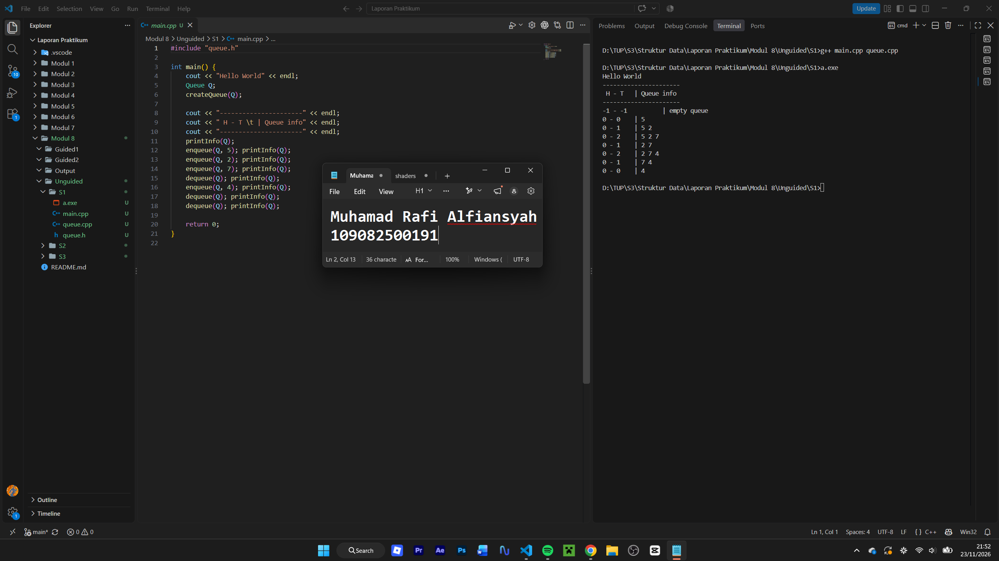
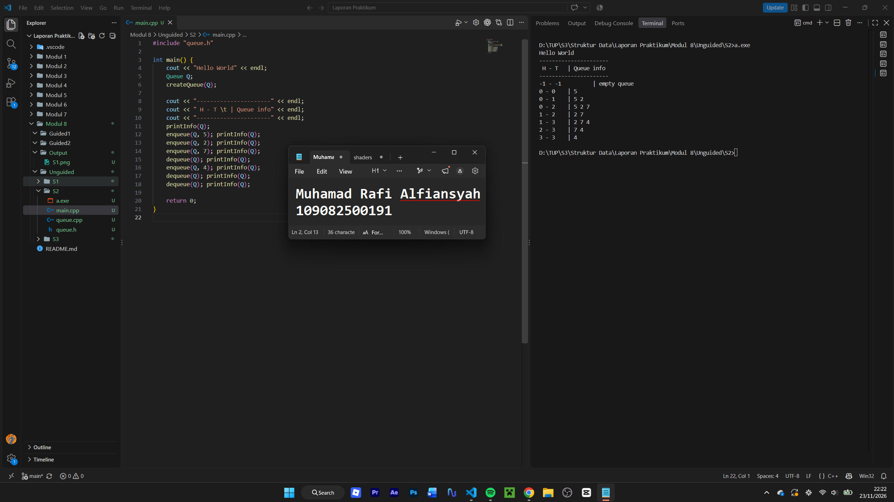
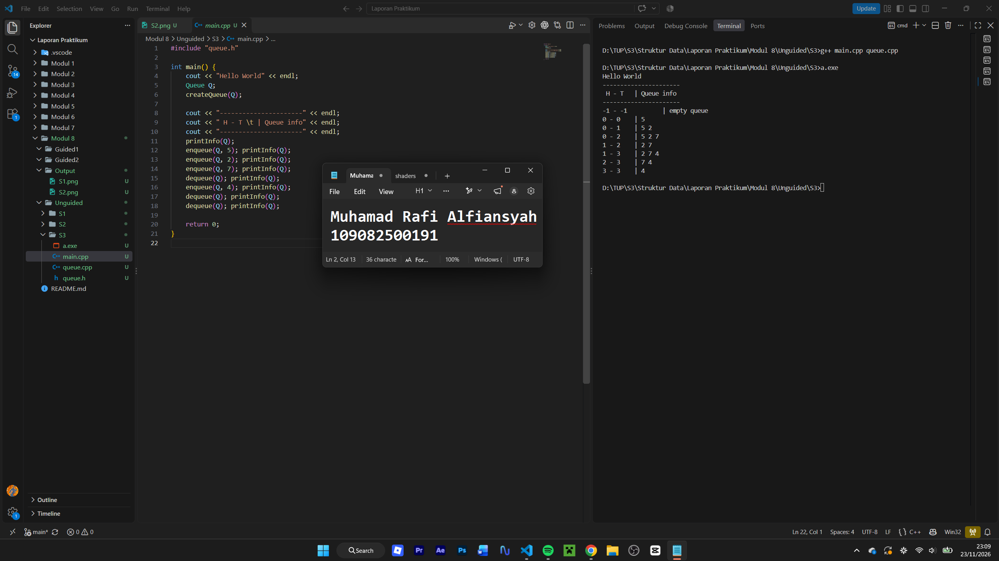

# <h1 align="center">Laporan Praktikum Modul 8 - QUEUE </h1>

<p align="center">Muhamad Rafi Alfiansyah - 109082500191</p>

## Dasar Teori

### A. Stack

Stack adalah struktur data linear yang menerapkan prinsip LIFO (Last In First Out), artinya data yang terakhir masuk akan jadi yang pertama keluar. Gampangnya seperti tumpukan piring, kita cuma bisa menaruh piring baru di paling atas dan mengambil juga dari paling atas. Karena itu semua operasi pada stack hanya terjadi di satu ujung, yang disebut top. Kalau mau mengambil data yang ada di bawah, data di atasnya harus dikeluarkan dulu.

### B. Stack dengan Array

Pada praktikum ini stack dibuat dengan ADT berbasis array. Stack disusun dari array info yang berisi maksimal 20 elemen dan variabel top yang menandai posisi elemen paling atas. Saat stack baru dibuat (createStack), top bernilai 0 yang berarti stack kosong. Operasi push menambah nilai top lebih dulu, baru data disimpan di info[top], sedangkan pop mengambil data di info[top] lalu mengurangi nilai top. Kalau stack sudah penuh lalu di-push terjadi overflow, dan kalau stack kosong lalu di-pop terjadi underflow. Keduanya perlu dicek. Kelebihannya implementasinya simpel dan hemat memori karena tidak butuh pointer, kekurangannya ukuran stack tetap sehingga tidak bisa bertambah saat program berjalan. Operasi push dan pop sama-sama O(1).

### C. Operasi pada Latihan

Selain push dan pop, ada beberapa operasi lain. printInfo menampilkan isi stack dari top ke bawah, jadi urutan tampilnya kebalikan dari urutan masuk. balikStack membalik isi stack dengan menukar elemen paling bawah dan paling atas, bergerak ke tengah sampai selesai. pushAscending menyisipkan data sambil menjaga stack tetap terurut naik dari bawah ke atas, caranya dengan menggeser elemen yang lebih besar dari data baru ke atas dulu. Terakhir, getInputStream membaca input user per karakter memakai cin.get() dan langsung mem-push setiap karakternya sampai user menekan enter.


## Guided 1

### 1. Guided Queue Representasi Linked List

**`queue.h`**

```cpp
#ifndef QUEUE_H
#define QUEUE_H

#include <iostream>
#include <string>
using namespace std;
const int MaxQueue = 20;

struct Node {
    string nama;
    Node* next;
};

struct queue {
    Node *head, *tail;
};

void createQueue(queue &Q);
bool isEmpty(queue Q);
bool isFull(queue Q);
void enqueue(queue &Q, const string &nama);
void dequeue(queue &Q);
void viewQueue(queue Q);
void clearQueue(queue &Q);
#endif
```

**`queue.cpp`**

```cpp
#include "queue.h"

void createQueue(queue &Q){
    Q.head = NULL;
    Q.tail = NULL;
}

bool isEmpty(queue Q){
    return (Q.head == NULL && Q.tail == NULL);
}

bool isFull(queue Q){
    Node *nodeBantu = Q.head;
    int count = 0;
    while(nodeBantu != NULL){
        count++;
        nodeBantu = nodeBantu->next;
    }
    return (count >= MaxQueue);
}

void enqueue(queue &Q, const string &nama){
    if(isEmpty(Q)){
        Node *nodeBaru = new Node{nama, NULL};
        Q.head = nodeBaru;
        Q.tail = nodeBaru;
    }else {
        Node *nodeBantu = new Node{nama, NULL};
        Q.tail->next = nodeBantu;
        Q.tail = nodeBantu;
    }
}

void dequeue(queue &Q){
    if(isEmpty(Q)){
        cout << "Queue kosong!" << endl;
    } else {
        Node *nodeHapus = Q.head;
        Q.head = Q.head->next;
        if(Q.head == NULL){
            Q.tail = NULL;
        }
        delete nodeHapus;
    }
}

void viewQueue(queue Q){
    if(isEmpty(Q)){
        cout << "Queue kosong!" << endl;
    } else {
        Node *nodeBantu = Q.head;
        while(nodeBantu != NULL){
            cout << "Nama : " << nodeBantu->nama << " ";
            nodeBantu = nodeBantu->next;
        }
        cout << endl;
    }
}

void clearQueue(queue &Q){
    while(!isEmpty(Q)){
        dequeue(Q);
    }
}
```

**`main.cpp`**

```cpp
#include "queue.h"
#include <iostream>
using namespace std;

int main (){
    queue Q;
    createQueue(Q);

    enqueue(Q, "Dominic");
    enqueue(Q, "Torr");
    enqueue(Q, "Retto");
    enqueue(Q, "Letty");
    enqueue(Q, "Brian");
    enqueue(Q, "Mia");
    cout << "Isi Queue sebelum di dequeue: " << endl;
    viewQueue(Q);
    dequeue(Q);
    dequeue(Q);
    dequeue(Q);
    dequeue(Q);
    cout << "Isi Queue setelah di dequeue: " << endl;
    viewQueue(Q);
    return 0;
}
```

Membuat stack dengan representasi array berukuran maksimal 10, dengan top sebagai penanda elemen paling atas dan nilai -1 yang berarti stack masih kosong. Stack dibuat dulu lewat createStack, lalu diisi angka 1 sampai 5 menggunakan push dan ditampilkan dengan view dari top ke bawah. Setelah itu dilakukan pop dua kali sehingga dua data teratas terhapus, kemudian update dipakai untuk mengubah data berdasarkan posisinya yang dihitung dari top, yaitu posisi ke-2 dan ke-1 dengan nilai baru yang diinput user. Terakhir, searchData mencari angka 4 dan 9, lalu menampilkan posisinya kalau ketemu atau pesan tidak ditemukan kalau tidak ada. Setiap operasi dicek dulu dengan isEmpty dan isFull supaya tidak terjadi underflow maupun overflow.

## Guided 2

### 2. Guided Queue Representasi Array

**`queue.h`**

```cpp
#ifndef QUEUE_H
#define QUEUE_H

#include <iostream>
using namespace std;

const int MAKSIMAL = 5;

struct queue {
    string nama[MAKSIMAL];
    int head;
    int tail;
};

bool isFull(queue Q);
bool isEmpty(queue Q);
void CreateQueue(queue &Q);
void enQueue(queue &Q, const string &nama);
void deQueue(queue &Q);
void viewQueue(queue Q);
void clearQueue(queue &Q);

#endif
```

**`queue.cpp`**

```cpp
#include "queue.h"
#include <iostream>

using namespace std;

bool isEmpty(queue Q){
    if(Q.head == -1 && Q.tail == -1){
        return true;
    } else {
        return false;
    }
}

bool isFull(queue Q){
    if(Q.tail == MAKSIMAL - 1){
        return true;
    } else {
        return false;
    }
}

void CreateQueue(queue &Q){
    Q.head = -1;
    Q.tail = -1;
}

void enQueue(queue &Q, string nama){
    if(isFull(Q) == true){
        cout << "Queue sudah penuh!" << endl;
    } else {
        if(isEmpty(Q) == true){
            Q.head = Q.tail = 0;
        } else {
            Q.tail++;
        }
        Q.nama[Q.tail] = nama;
        cout << "nama " << nama << " berhasil ditambahkan kedalam queue!" << endl;
    }
}

void deQueue(queue &Q){
    if(isEmpty(Q) == true){
        cout << "Queue kosong!" << endl;
    } else {
        cout << "Mengahapus data " << Q.nama[Q.head] << "..." << endl;
        for(int i = 0; i < Q.tail; i++){
            Q.nama[i] = Q.nama[i+1];
        }
        Q.tail--;
        if(Q.tail < 0){
            Q.head = -1;
            Q.tail = -1;
        }
    }
}

void viewQueue(queue Q){
    if(isEmpty(Q) == true){
        cout << "Queue kosong!" << endl;
    } else {
        for(int i = Q.head; i <= Q.tail; i++){
            cout << i - Q.head + 1 << ". " << Q.nama[i] << endl;
        }
    }
    cout << endl;
}
```

**`main.cpp`**

```cpp
#include "queue.h"
#include <iostream>

using namespace std;

int main(){
    queue Q;

    CreateQueue(Q);
    enQueue(Q, "Dimas");
    enQueue(Q, "Arvin");
    enQueue(Q, "Rizal");
    enQueue(Q, "Hafizh");
    enQueue(Q, "Fathur");
    enQueue(Q, "Daffa");
    cout << endl;

    cout << "--- Isi Queue Setelah enQueue ---" << endl;
    viewQueue(Q);
    cout << endl;

    deQueue(Q);
    deQueue(Q);
    deQueue(Q);
    deQueue(Q);
    cout << endl;

    cout << "--- Isi Queue Setelah deQueue ---" << endl;
    viewQueue(Q);

    return 0;
}
```
Membuat stack dengan representasi linked list, jadi setiap data disimpan dalam node yang punya dataAngka dan pointer next, sedangkan top menunjuk node paling atas dan bernilai Nil kalau stack kosong. Node dibuat dulu dengan alokasi, lalu dimasukkan lewat push yang menaruh node baru di atas top, sehingga pada main angka 1 sampai 5 masuk berurutan dan isinya ditampilkan dari 5 ke 1 oleh view. Operasi pop menghapus node paling atas dengan memindahkan top ke node berikutnya lalu melepas memorinya dengan dealokasi, dan dilakukan dua kali sehingga tersisa tiga node. Setelah itu update mengubah data berdasarkan posisi yang dihitung dari top dengan menelusuri pointer next, dan posisi ke-4 dinyatakan tidak valid karena node yang tersisa hanya tiga. Terakhir, searchData menelusuri node dari top untuk mencari angka 4 dan 9, lalu menampilkan posisinya kalau ketemu atau pesan tidak ditemukan kalau tidak ada.

## Unguided

### 1.  Soal 1 - Alternatif 1: `Head` Diam dan `Tail` Bergerak 

**`queue.h`**

```cpp
#ifndef QUEUE_H
#define QUEUE_H

#include <iostream>
using namespace std;

const int MAX = 5;

typedef int infotype;

struct Queue {
    infotype info[MAX];
    int head;
    int tail;
};

void createQueue(Queue &Q);
bool isEmptyQueue(Queue Q);
bool isFullQueue(Queue Q);
void enqueue(Queue &Q, infotype x);
infotype dequeue(Queue &Q);
void printInfo(Queue Q);

#endif

```

**`queue.cpp`**

```cpp
#include "queue.h"

void createQueue(Queue &Q) {
    Q.head = -1;
    Q.tail = -1;
}

bool isEmptyQueue(Queue Q) {
    return Q.head == -1 && Q.tail == -1;
}

bool isFullQueue(Queue Q) {
    return Q.tail == MAX - 1;
}

void enqueue(Queue &Q, infotype x) {
    if (isFullQueue(Q)) {
        cout << "Queue penuh" << endl;
        return;
    }
    if (isEmptyQueue(Q)) {
        Q.head = 0;
        Q.tail = 0;
    } else {
        Q.tail++;
    }
    Q.info[Q.tail] = x;
}

infotype dequeue(Queue &Q) {
    if (isEmptyQueue(Q)) {
        cout << "Queue kosong" << endl;
        return -1;
    }
    infotype x = Q.info[Q.head];
    for (int i = Q.head; i < Q.tail; i++) {
        Q.info[i] = Q.info[i + 1];
    }
    Q.tail--;
    if (Q.tail < Q.head) {
        Q.head = -1;
        Q.tail = -1;
    }
    return x;
}

void printInfo(Queue Q) {
    cout << Q.head << " - " << Q.tail << " \t | ";
    if (isEmptyQueue(Q)) {
        cout << "empty queue" << endl;
        return;
    }
    for (int i = Q.head; i <= Q.tail; i++) {
        cout << Q.info[i] << " ";
    }
    cout << endl;
}

```

**`main.cpp`**

```cpp
#include "queue.h"

int main() {
    cout << "Hello World" << endl;
    Queue Q;
    createQueue(Q);

    cout << "----------------------" << endl;
    cout << " H - T \t | Queue info" << endl;
    cout << "----------------------" << endl;
    printInfo(Q);
    enqueue(Q, 5); printInfo(Q);
    enqueue(Q, 2); printInfo(Q);
    enqueue(Q, 7); printInfo(Q);
    dequeue(Q); printInfo(Q);
    enqueue(Q, 4); printInfo(Q);
    dequeue(Q); printInfo(Q);
    dequeue(Q); printInfo(Q);

    return 0;
}

```

### 2. Soal 2 - Alternatif 2: `Head` dan `Tail` Bergerak

**`queue.h`**

```cpp
#ifndef QUEUE_H
#define QUEUE_H

#include <iostream>
using namespace std;

const int MAX = 5;

typedef int infotype;

struct Queue {
    infotype info[MAX];
    int head;
    int tail;
};

void createQueue(Queue &Q);
bool isEmptyQueue(Queue Q);
bool isFullQueue(Queue Q);
void enqueue(Queue &Q, infotype x);
infotype dequeue(Queue &Q);
void printInfo(Queue Q);

#endif
```

**`queue.cpp`**

```cpp
#include "queue.h"

void createQueue(Queue &Q) {
    Q.head = -1;
    Q.tail = -1;
}

bool isEmptyQueue(Queue Q) {
    return Q.head == -1 && Q.tail == -1;
}

bool isFullQueue(Queue Q) {
    return Q.head == 0 && Q.tail == MAX - 1;
}

void enqueue(Queue &Q, infotype x) {
    if (isFullQueue(Q)) {
        cout << "Queue penuh" << endl;
        return;
    }
    if (isEmptyQueue(Q)) {
        Q.head = 0;
        Q.tail = 0;
    } else {
        if (Q.tail == MAX - 1) {
            int n = Q.tail - Q.head + 1;
            for (int i = 0; i < n; i++) {
                Q.info[i] = Q.info[Q.head + i];
            }
            Q.head = 0;
            Q.tail = n - 1;
        }
        Q.tail++;
    }
    Q.info[Q.tail] = x;
}

infotype dequeue(Queue &Q) {
    if (isEmptyQueue(Q)) {
        cout << "Queue kosong" << endl;
        return -1;
    }
    infotype x = Q.info[Q.head];
    if (Q.head == Q.tail) {
        Q.head = -1;
        Q.tail = -1;
    } else {
        Q.head++;
    }
    return x;
}

void printInfo(Queue Q) {
    cout << Q.head << " - " << Q.tail << " \t | ";
    if (isEmptyQueue(Q)) {
        cout << "empty queue" << endl;
        return;
    }
    for (int i = Q.head; i <= Q.tail; i++) {
        cout << Q.info[i] << " ";
    }
    cout << endl;
}

```

**`main.cpp`**

```cpp
#include "queue.h"

int main() {
    cout << "Hello World" << endl;
    Queue Q;
    createQueue(Q);

    cout << "----------------------" << endl;
    cout << " H - T \t | Queue info" << endl;
    cout << "----------------------" << endl;
    printInfo(Q);
    enqueue(Q, 5); printInfo(Q);
    enqueue(Q, 2); printInfo(Q);
    enqueue(Q, 7); printInfo(Q);
    dequeue(Q); printInfo(Q);
    enqueue(Q, 4); printInfo(Q);
    dequeue(Q); printInfo(Q);
    dequeue(Q); printInfo(Q);

    return 0;
}
```

### 3. Soal 3 - Alternatif 3: `Head` dan `Tail` Berputar

**`queue.h`**

```cpp
#ifndef QUEUE_H
#define QUEUE_H

#include <iostream>
using namespace std;

const int MAX = 5;

typedef int infotype;

struct Queue {
    infotype info[MAX];
    int head;
    int tail;
};

void createQueue(Queue &Q);
bool isEmptyQueue(Queue Q);
bool isFullQueue(Queue Q);
void enqueue(Queue &Q, infotype x);
infotype dequeue(Queue &Q);
void printInfo(Queue Q);

#endif

```

**`queue.cpp`**

```cpp
#include "queue.h"

void createQueue(Queue &Q) {
    Q.head = -1;
    Q.tail = -1;
}

bool isEmptyQueue(Queue Q) {
    return Q.head == -1 && Q.tail == -1;
}

bool isFullQueue(Queue Q) {
    return !isEmptyQueue(Q) && (Q.tail + 1) % MAX == Q.head;
}

void enqueue(Queue &Q, infotype x) {
    if (isFullQueue(Q)) {
        cout << "Queue penuh" << endl;
        return;
    }
    if (isEmptyQueue(Q)) {
        Q.head = 0;
        Q.tail = 0;
    } else {
        Q.tail = (Q.tail + 1) % MAX;
    }
    Q.info[Q.tail] = x;
}

infotype dequeue(Queue &Q) {
    if (isEmptyQueue(Q)) {
        cout << "Queue kosong" << endl;
        return -1;
    }
    infotype x = Q.info[Q.head];
    if (Q.head == Q.tail) {
        Q.head = -1;
        Q.tail = -1;
    } else {
        Q.head = (Q.head + 1) % MAX;
    }
    return x;
}

void printInfo(Queue Q) {
    cout << Q.head << " - " << Q.tail << " \t | ";
    if (isEmptyQueue(Q)) {
        cout << "empty queue" << endl;
        return;
    }
    int n = (Q.tail - Q.head + MAX) % MAX + 1;
    int i = Q.head;
    for (int k = 0; k < n; k++) {
        cout << Q.info[i] << " ";
        i = (i + 1) % MAX;
    }
    cout << endl;
}

```

**`main.cpp`**

```cpp
#include "queue.h"

int main() {
    cout << "Hello World" << endl;
    Queue Q;
    createQueue(Q);

    cout << "----------------------" << endl;
    cout << " H - T \t | Queue info" << endl;
    cout << "----------------------" << endl;
    printInfo(Q);
    enqueue(Q, 5); printInfo(Q);
    enqueue(Q, 2); printInfo(Q);
    enqueue(Q, 7); printInfo(Q);
    dequeue(Q); printInfo(Q);
    enqueue(Q, 4); printInfo(Q);
    dequeue(Q); printInfo(Q);
    dequeue(Q); printInfo(Q);

    return 0;
}

```

#### Output Unguided



Membuat ADT Stack dengan array berukuran 20 yang dilengkapi variabel top sebagai penanda elemen paling atas. Stack dibuat kosong lewat createStack dengan nilai top 0, lalu data ditambahkan memakai push dan dikeluarkan memakai pop sesuai prinsip LIFO. Pada main, data 3, 4, dan 8 dimasukkan, lalu 8 di-pop, 2 dan 3 dimasukkan, 3 di-pop lagi, dan terakhir 9 dimasukkan. Isi stack ditampilkan dengan printInfo dari top ke bawah sehingga hasilnya 9 2 4 3, kemudian dibalik dengan balikStack dan ditampilkan lagi menjadi 3 4 2 9.



Ditambahkan prosedur pushAscending untuk memasukkan data sambil menjaga isi stack tetap terurut naik dari bawah ke atas. Saat data baru masuk, elemen di atasnya yang lebih besar digeser satu posisi ke atas dulu, lalu data baru disimpan di posisi yang kosong tadi dan top bertambah satu. Data 3, 4, 8, 2, 3, dan 9 dimasukkan dengan cara ini sehingga saat ditampilkan dari top hasilnya 9 8 4 3 3 2. Setelah stack dibalik dengan balikStack, urutan tampilnya menjadi 2 3 3 4 8 9.



Ditambahkan prosedur getInputStream yang membaca input dari user satu karakter demi satu memakai cin.get(). Setiap karakter yang dibaca diubah menjadi angka lalu langsung dimasukkan ke stack dengan push, dan proses ini berhenti ketika user menekan enter. Sebagai contoh, input 4729601 akan tersimpan berurutan sehingga printInfo menampilkannya dari top menjadi 1 0 6 9 2 7 4. Setelah dibalik dengan balikStack, hasilnya kembali sama dengan urutan input, yaitu 4 7 2 9 6 0 1.

## Kesimpulan

Saya jadi lebih memahami cara kerja Stack dan bagaimana struktur data ini menyimpan serta mengelola data dengan prinsip LIFO. Saya belajar membuat ADT Stack dengan array, mulai dari createStack, push, pop, sampai menampilkan isi stack dengan printInfo. Saya juga memahami peran top sebagai penanda elemen paling atas yang berubah setiap kali data ditambah atau dihapus. Selain itu, saya belajar membalik isi stack dengan balikStack, menyisipkan data secara terurut dengan pushAscending, dan memasukkan input user ke stack dengan getInputStream. Melalui praktikum ini, saya dapat lebih memahami penerapan Stack dalam program C++.

## Referensi

[1] OpenDSA. (t.t.). Stacks. https://opendsa-server.cs.vt.edu/ODSA/Books/CS2/html/StackArray.html

[2] GeeksforGeeks. (t.t.). Stack Data Structure. https://www.geeksforgeeks.org/dsa/stack-data-structure/

[3] Programiz. (t.t.). Stack Data Structure. https://www.programiz.com/dsa/stack

[4] Setiyawan, R. D., dkk. (2024). Penggunaan Struktur Data Stack dalam Pemrograman C++ dengan Pendekatan Array dan Linked List. JUTECH, 5(2). https://jurnal.stkippersada.ac.id/jurnal/index.php/jutech/article/download/4263/pdf
